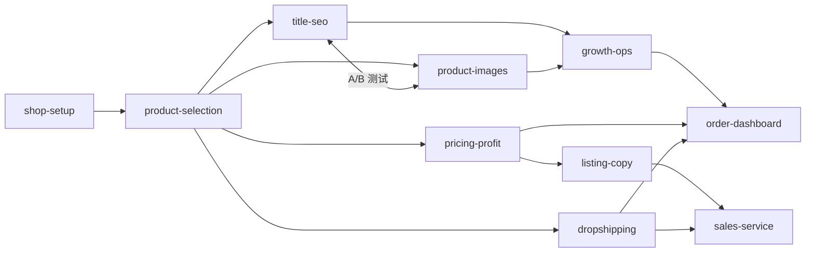

# 《2026 年闲鱼电商副业保姆级教程》— Skill Index

> 本书由 cangjie-skill 流水线蒸馏，共产出 **10** 个 skills。
> 处理时间: 2026-10-04 ｜ 模式: pack（用户在不同运营环节独立调用）

## 关于这本书

- **作者**: 海底桃
- **发布**: 2026-08（飞书知识库）
- **一句话主旨**: 用无货源一件代发模式在闲鱼开副业店——选品是 1、运营是 0
- **整书理解**: 见 [BOOK_OVERVIEW.md](./BOOK_OVERVIEW.md)
- **术语词典**: 见 [GLOSSARY.md](./GLOSSARY.md)
- **源文本**: 完整抓取版留存本地未入库（版权考虑）；各 skill 的 R 段含关键原文引用

---

## Skill 列表（按运营旅程排序）

### 开店基建

- [`xianyu-shop-setup`](./xianyu-shop-setup/SKILL.md) — 账号防限流配置 + 专业卖家人设四件套
- [`xianyu-product-selection`](./xianyu-product-selection/SKILL.md) — 选品漏斗：抄同行 → 测品 → 避坑（选品是 1）

### 链接制作

- [`xianyu-title-seo`](./xianyu-title-seo/SKILL.md) — 标题三方法 + 前缀词 + 堆砌规避
- [`xianyu-product-images`](./xianyu-product-images/SKILL.md) — 9 张图规划 + 合规图源 + 实拍感修图
- [`xianyu-listing-copy`](./xianyu-listing-copy/SKILL.md) — 详情七段结构 + 静默单策略
- [`xianyu-pricing-profit`](./xianyu-pricing-profit/SKILL.md) — 真实净利公式 + 低价引流 SKU + 支付摩擦优化

### 履约与增长

- [`xianyu-dropshipping`](./xianyu-dropshipping/SKILL.md) — 1688/拼多多代发 + 无痕发货 + 痕迹消除
- [`xianyu-growth-ops`](./xianyu-growth-ops/SKILL.md) — 每日运营四件套 + 补单体系（灰色操作，强制风险声明）

### 交易与数据

- [`xianyu-sales-service`](./xianyu-sales-service/SKILL.md) — 询单话术五板斧 + 售后三件套 + 两条红线
- [`xianyu-order-dashboard`](./xianyu-order-dashboard/SKILL.md) — 出单表 8 字段 + 每周两张复盘表 + 品去留规则

---

## 引用图

图例: `-->` depends-on ｜ `<-->` 相互依赖 ｜ 组合关系见各 skill 的「相关 skills」段

---

## 快速路由

| 用户情形 | 调用 |
|---|---|
| "我想开始做闲鱼" | shop-setup → product-selection |
| "商品没人看/没曝光" | title-seo + product-images |
| "有人看不下单" | listing-copy + pricing-profit |
| "有人下单了" | dropshipping |
| "想要更多单" | growth-ops |
| "买家来问了/售后了" | sales-service |
| "单多了乱/赚没赚 unclear" | order-dashboard |
